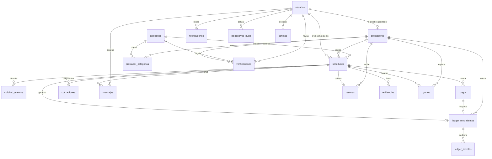
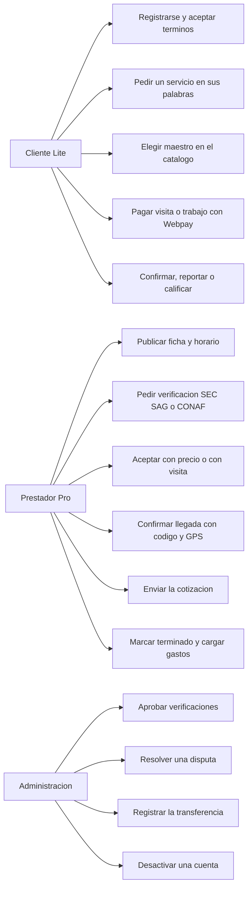

# Diagramas para el informe técnico

Modelo y casos de uso del software que está en el repositorio (migraciones `001` a `020` y pantallas de Lite, Pro y el panel). Sirven para pegarlos en el informe; el dibujo de arquitectura sigue en [img/arquitectura.png](img/arquitectura.png).

## Entidad-relación

Los montos son pesos enteros. El ledger no se borra y una reseña solo puede apuntar a una solicitud cerrada: esas reglas están en la base, no solo en la API.

Tablas de apoyo que no cambian el flujo: `boletas` (foto leída por el OCR), `inscripciones` (alta de la tarjeta en Webpay), `codigos_recuperacion` (código de un solo uso) y `schema_migrations`.

Categorías que exigen verificación antes de salir en el catálogo: electricidad y gas (SEC), agroquímicos (SAG) y tala (CONAF).

## Casos de uso

### Cliente (DeliMaster Lite)

1. Crear cuenta, aceptar la versión vigente de los términos y recuperar la contraseña con un código.
2. Describir el trabajo en lenguaje natural. Sin señal, el pedido queda en el celular y se envía al volver la red.
3. Filtrar el catálogo por oficio y comuna y abrir el perfil del prestador.
4. Asignar un prestador y pagar la visita o el precio cerrado. El monto lo fija el servidor.
5. Dictar el código de llegada. Aceptar o rechazar la cotización y pagar el saldo.
6. Chatear. Confirmar el cierre, reportar un problema con fotos o calificar un trabajo cerrado.

### Prestador (DeliMaster Pro)

1. Completar ficha, comunas, horario y datos bancarios.
2. Pedir verificación. Electricidad y gas llevan el código del certificado SEC. Tala lleva el registro de CONAF. Agroquímicos, el del SAG. El panel aprueba mirando el sitio del organismo.
3. Aceptar o rechazar dentro de 30 minutos. Si no responde, la solicitud vuelve a quedar libre aunque nadie tenga la app abierta.
4. En una visita, ingresar el código del cliente. Si el cliente marcó el punto, la app envía el GPS y el servidor exige estar a menos de 1.500 metros.
5. Cotizar, marcar el trabajo terminado, fotografiar boletas y ver el mes en finanzas.

### Administración

1. Ver indicadores, verificaciones por revisar, disputas y pagos por transferir.
2. Aprobar o rechazar una verificación, con vencimiento cuando el organismo lo exige.
3. Abrir la evidencia (chat, fotos, pago, punto de llegada) y liberar, reembolsar o devolver una parte.
4. Registrar una transferencia con comprobante, o desactivar una cuenta con mensajes bloqueados.
